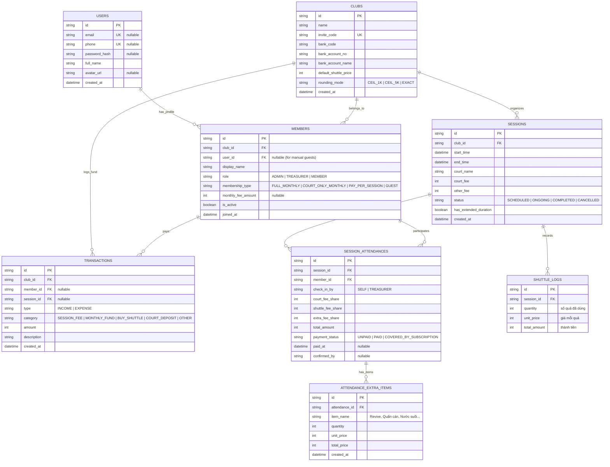

# Kiến Trúc Hệ Thống & Mô Hình Dữ Liệu (Architecture & Data Schema)

## 1. Công Nghệ Đề Xuất (Tech Stack)
- **Framework**: Next.js 14+ (App Router) với Server Actions và React Server Components.
- **Xác thực (Authentication)**: NextAuth.js (Auth.js) hoặc Supabase Auth (Hỗ trợ Email/Password, Google OAuth, SĐT).
- **Styling**: Tailwind CSS + Shadcn UI (Radix UI) - tuân thủ triệt để [frontend-design skill](../.agents/skills/frontend-design/SKILL.md).
- **Database**: PostgreSQL (Supabase / Neon / PostgreSQL).
- **ORM**: Prisma ORM hoặc Drizzle ORM (Type-safe migrations).
- **Thanh toán**: VietQR Napas247 QuickLink.
- **Tiêu chuẩn Responsive Breakpoints**:
  - `Mobile` (< 640px): 1-column layout, bottom sticky bars, touch targets $\ge 44$px.
  - `Tablet` (640px - 1024px): 2-column split view (Attendance + Live Bill).
  - `Desktop` (> 1024px): Dashboard layout với Collapsible Sidebar & Data Tables.

- **Tài liệu triển khai chi tiết**: Xem [docs/DEPLOYMENT.md](file:///e:/BSM_BadmintonSportManager/docs/DEPLOYMENT.md).

---

## 2. Sơ Đồ Thực Thể Quan Hệ (Entity Relationship Diagram - ERD)



---

## 3. Kiến Trúc Thư Mục Source Code Thực Tế

```text
src/
├── app/                         # Next.js 14 App Router
│   ├── (auth)/                  # Đăng nhập (/login), đăng ký (/register)
│   ├── api/auth/                # NextAuth route handler ([...nextauth])
│   ├── dashboard/               # Bảng điều khiển cá nhân (Debt Tracker & CLB của tôi)
│   ├── profile/                 # Hồ sơ cá nhân, lịch sử đóng tiền & nợ
│   ├── clubs/                   # Quản lý CLB
│   │   ├── new/                 # Tạo CLB mới, cấu hình VietQR & giá cầu
│   │   └── [id]/                # Chi tiết CLB 4-Tab Hub (Buổi đánh, Sổ quỹ, Bảng nợ, Hội viên)
│   │       └── sessions/new/    # Tạo buổi đánh mới (Server guard 3 lớp)
│   ├── sessions/                # Chi tiết buổi đánh
│   │   └── [id]/                # Điểm danh 2 chiều, đếm cầu, phụ phí riêng, gia hạn giờ
│   │       └── split/           # Bảng chia tiền thông minh & VietQR Napas247 động
│   ├── join/[code]/             # Tham gia CLB bằng mã mời
│   ├── error.tsx                # Global Error Boundary (kèm F5 reload & dashboard link)
│   └── not-found.tsx            # Global 404 Not Found Page
├── components/
│   ├── navbar.tsx               # Header điều hướng chung
│   ├── club/                    # Hub tabs, TreasuryView, DebtTrackerView, MemberManagement, Modals
│   ├── session/                 # AttendanceBoard, ShuttleCounter, ExtraFeeWidget, SplitBillView
│   └── profile/                 # ProfileHub (Tổng hợp nợ, lịch sử thanh toán)
├── lib/
│   ├── auth.ts                  # Cấu hình NextAuth v5 (hỗ trợ insensitive email & phone login)
│   ├── db.ts                    # Prisma Client singleton
│   ├── utils.ts                 # formatVND, roundFee, generateVietQRUrl, removeVietnameseAccents
│   └── vietqr.ts                # Generator link VietQR QuickLink
└── server/
    └── actions/                 # Next.js Server Actions (auth, club, member, session, treasury)
```
