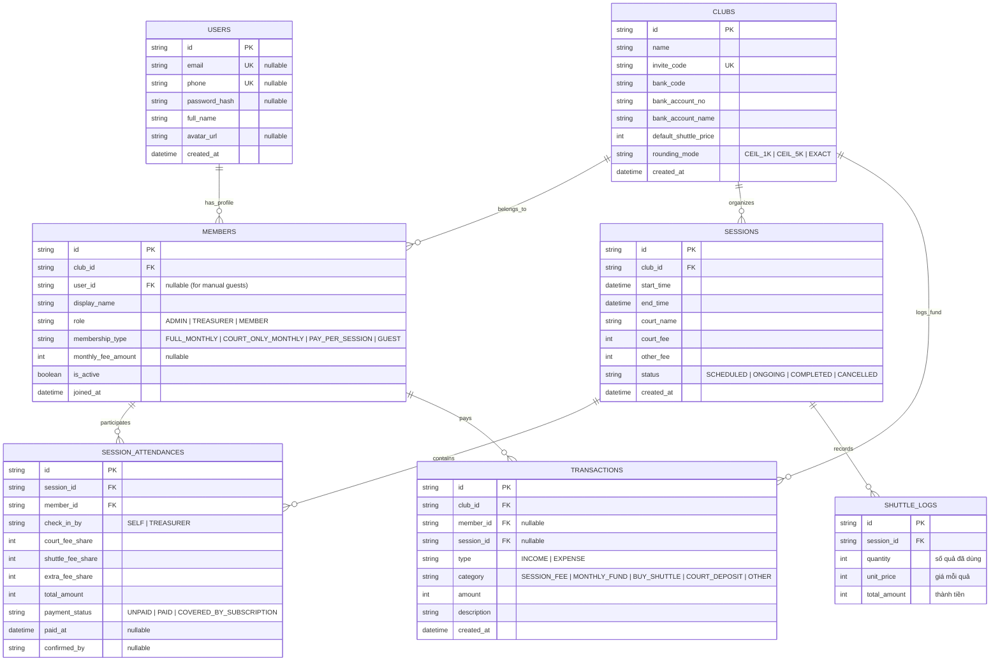

# Kiến Trúc Hệ Thống & Mô Hình Dữ Liệu (Architecture & Data Schema)

## 1. Công Nghệ Đề Xuất (Tech Stack)
- **Framework**: Next.js 14+ (App Router) với Server Actions và React Server Components.
- **Xác thực (Authentication)**: NextAuth.js (Auth.js) hoặc Supabase Auth (Hỗ trợ Email/Password, Google OAuth, SĐT).
- **Styling**: Tailwind CSS + Shadcn UI (Radix UI) - tuân thủ triệt để [frontend-design skill](../.agents/skills/frontend-design/SKILL.md).
- **Database**: PostgreSQL (Supabase / Neon / PostgreSQL).
- **ORM**: Prisma ORM hoặc Drizzle ORM (Type-safe migrations).
- **Thanh toán**: VietQR Napas247 QuickLink.
- **Tiêu chuẩn Responsive Breakpoints**:
  - `Mobile` (< 640px): 1-column layout, bottom sticky bars, touch targets $\ge 44$px.
  - `Tablet` (640px - 1024px): 2-column split view (Attendance + Live Bill).
  - `Desktop` (> 1024px): Dashboard layout với Collapsible Sidebar & Data Tables.

- **Tài liệu triển khai chi tiết**: Xem [docs/DEPLOYMENT.md](file:///e:/BSM_BadmintonSportManager/docs/DEPLOYMENT.md).

---

## 2. Sơ Đồ Thực Thể Quan Hệ (Entity Relationship Diagram - ERD)



---

## 3. Kiến Trúc Thư Mục Source Code Dự Kiến

```text
src/
├── app/                         # App Router
│   ├── (auth)/                  # Đăng nhập, đăng ký, quên mật khẩu
│   ├── dashboard/               # Trang chủ người dùng (lịch đánh, số nợ của tôi)
│   ├── sessions/                # Quản lý buổi đánh
│   │   ├── [id]/
│   │   │   ├── page.tsx         # Chi tiết buổi đánh & hóa đơn cá nhân
│   │   │   └── check-in/        # Màn hình điểm danh & cập nhật số cầu
│   ├── members/                 # Quản lý danh sách thành viên & gói tháng
│   ├── treasury/                # Quản lý sổ quỹ & đối soát thanh toán
│   └── settings/                # Cài đặt CLB & tài khoản nhận VietQR
├── components/
│   ├── ui/                      # Base UI (Button, Dialog, Input, Card...)
│   ├── session/                 # ShuttleCounter (+ / -), CheckInToggle, BillSummary
│   └── payment/                 # VietQRCodeCard, PaymentStatusBadge
├── lib/
│   ├── auth/                    # NextAuth / Supabase helper
│   ├── finance/                 # Pure calculation logic (làm tròn, chia bill)
│   ├── vietqr.ts                # Generator link VietQR QuickLink
│   └── utils.ts
├── server/
│   ├── db.ts                    # Prisma / Drizzle connection
│   └── actions/                 # Server actions (auth, session, attendance, finance)
└── types/
    └── index.ts                 # Type definitions
```
