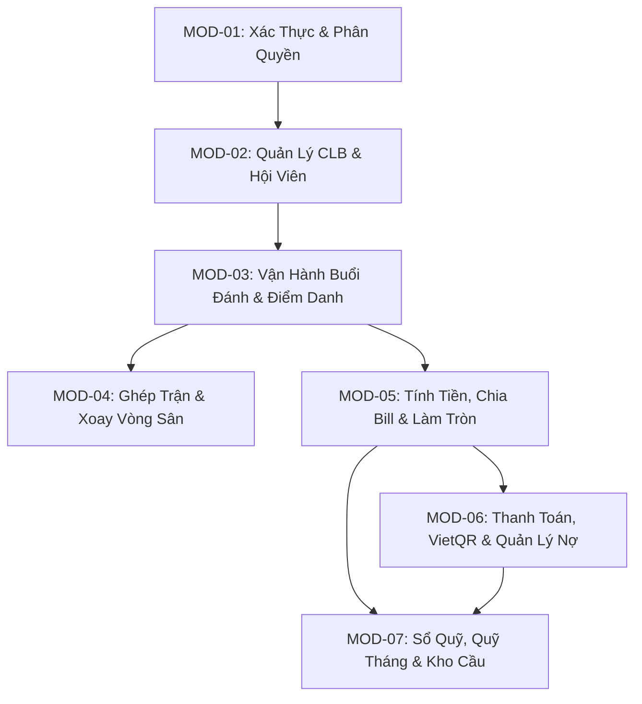

# TỔNG QUAN HỆ THỐNG & NGHIỆP VỤ BSM (BUSINESS OVERVIEW)
## Badminton Sport Manager - Nền Tảng Quản Lý Nhóm & Vận Hành Cầu Lông Phong Trào

---

## 1. Bối Cảnh Thực Tế & Bài Toán Nghiệp Vụ

Tại Việt Nam, phong trào cầu lông phát triển mạnh mẽ với hàng chục nghìn câu lạc bộ (CLB) và nhóm chơi tự phát hoạt động hàng ngày. Tuy nhiên, việc vận hành nhóm cầu lông thực tế đang gặp nhiều bài toán nan giải:

1. **Sự phức tạp trong cơ cấu thành viên:**
   - **Thành viên cố định trọn gói (Full Monthly):** Đóng tiền trọn gói đầu tháng (bao gồm tiền sân + tiền cầu), được chơi tất cả các buổi trong tháng mà không phải đóng tiền từng buổi.
   - **Thành viên cố định chỉ đóng tiền sân (Court-Only Monthly):** Đóng cố định tiền sân theo tháng, tiền cầu và nước uống tiêu hao trong buổi nào thì tính tiền buổi đó.
   - **Thành viên đóng theo buổi (Pay-Per-Session) & Khách vãng lai (Guest):** Chỉ đóng tiền khi có mặt tham gia, bao gồm cả tiền sân chia đều và tiền cầu/nước tiêu hao.
   - **Khách vãng lai có người bảo lãnh (Sponsored Guest):** Khách do thành viên trong nhóm dẫn đến, có thể thanh toán riêng hoặc tính gộp vào nợ của người bảo lãnh.

2. **Khó khăn trong tính toán & chia hóa đơn tại sân (Post-session Splitting):**
   - Tiền sân thường cố định theo giờ.
   - Tiền cầu phát sinh biến động tùy theo số lượng quả cầu mở nắp thực tế.
   - Phụ phí phát sinh đa dạng (nước suối chung, nước tăng lực/revive cá nhân, phí đan vợt khẩn cấp).
   - Quy tắc làm tròn tiền truyền thống tại Việt Nam (làm tròn lên 1.000đ hoặc 5.000đ để dễ chuyển khoản) tạo ra các khoản chênh lệch dôi dư (thặng dư) khó kiểm soát và dễ dẫn đến nghi kỵ tài chính.

3. **Bài toán công nợ dây dưa & thu tiền:**
   - Người chơi quên chuyển khoản sau buổi đánh.
   - Chuyển khoản sai cú pháp, thủ quỹ phải rà soát sao kê ngân hàng thủ công.
   - Nợ nhiều buổi nhỏ lẻ (30k, 45k, 60k) tích tụ thành các khoản nợ khó theo dõi.

4. **Quản lý kho cầu và quỹ nhóm:**
   - Cầu lông thường mua theo lốc (hộp 12 quả) từ quỹ nhóm. Khi đánh, mở cầu lẻ từng quả. Thiếu công cụ đối soát giữa số cầu tiêu thụ trong các buổi đánh và số cầu thực tế trong kho dẫn đến thất thoát.
   - Quỹ nhóm thu - chi thiếu minh bạch, các khoản thu từ quỹ tháng và thặng dư buổi đánh không được ghi chép đồng bộ.

5. **Tổ chức thi đấu tại sân:**
   - Số người đông hơn số sân (ví dụ 8-10 người trên 1 sân), cần công cụ sắp xếp lượt chơi công bằng, tránh tình trạng người chơi liên tục, người phải ngồi chờ quá lâu.

**Badminton Sport Manager (BSM)** được kiến tạo để giải quyết trọn vẹn toàn bộ các điểm nghẽn nghiệp vụ trên trong một nền tảng Mobile-first, hiện đại, minh bạch và chính xác tuyệt đối.

---

## 2. Các Tác Nhân Hệ Thống & Ma Trận Phân Quyền (Actors & RBAC Matrix)

Hệ thống phân định rõ 4 vai trò người dùng (User Roles) với các quyền hạn nghiệp vụ cụ thể:

| Phân Vùng Chức Năng | GUEST (Khách) | MEMBER (Hội viên) | TREASURER (Thủ quỹ) | ADMIN (Trưởng nhóm) |
| :--- | :---: | :---: | :---: | :---: |
| **Đăng ký / Đăng nhập hệ thống** | ❌ (Không bắt buộc) | ✅ | ✅ | ✅ |
| **Xem thông tin CLB & Danh sách buổi đánh** | ✅ (Chỉ buổi tham gia) | ✅ | ✅ | ✅ |
| **Đăng ký tham gia buổi (Join) / Rút lui (Leave)** | ❌ (Thủ quỹ add hộ) | ✅ | ✅ | ✅ |
| **Tự Check-in tại sân khi đến** | ❌ | ✅ | ✅ | ✅ |
| **Bốc thăm chia sân & xem lượt đấu** | ❌ (Chỉ xem) | ✅ (Chỉ xem) | ✅ (Tạo & Điều hành) | ✅ (Toàn quyền) |
| **Xem hóa đơn & Quét mã VietQR cá nhân** | ✅ | ✅ | ✅ | ✅ |
| **Tra cứu nợ cá nhân đa CLB (Debt Tracker)** | ❌ | ✅ | ✅ | ✅ |
| **Tạo buổi đánh mới** | ❌ | ❌ | ✅ | ✅ |
| **Điểm danh & Quản lý danh sách có mặt** | ❌ | ❌ | ✅ | ✅ |
| **Ghi nhận số cầu tiêu thụ & Phụ phí** | ❌ | ❌ | ✅ | ✅ |
| **Chốt chia tiền buổi đánh & Làm tròn** | ❌ | ❌ | ✅ | ✅ |
| **Gạch nợ đơn lẻ & Thanh toán gộp nhiều buổi** | ❌ | ❌ | ✅ | ✅ |
| **Quản lý Quỹ tháng & Ghi chép Sổ Quỹ** | ❌ | ❌ | ✅ | ✅ |
| **Quản lý Kho Cầu (Nhập kho, Kiểm kê)** | ❌ | ❌ | ✅ | ✅ |
| **Sao chép tin nhắn tổng hợp nợ gửi Zalo** | ❌ | ❌ | ✅ | ✅ |
| **Thêm / Chỉnh sửa / Phân quyền Hội viên** | ❌ | ❌ | ❌ | ✅ |
| **Cài đặt thông tin CLB & Tài khoản VietQR** | ❌ | ❌ | ❌ | ✅ |
| **Xóa buổi đánh / Soft-delete hội viên** | ❌ | ❌ | ❌ | ✅ |

---

## 3. Bản Đồ Phân Hệ Cốt Lõi (Core Module Map)

Hệ thống BSM được cấu trúc thành 7 phân hệ nghiệp vụ liên hoàn:

### Chi tiết các phân hệ:
1. **MOD-01: Xác Thực & Quản Lý Tài Khoản (Authentication & Security):**
   - Đăng ký, đăng nhập tài khoản người chơi bằng Email/Mật khẩu mã hóa bcrypt.
   - Phiên làm việc bảo mật với NextAuth.js v5.
   - Tự động gắn kết tài khoản người chơi với hồ sơ thành viên tại các CLB.

2. **MOD-02: Quản Lý CLB & Hồ Sơ Thành Viên (Club & Membership Management):**
   - Thiết lập thông tin CLB, cấu hình ngân hàng thụ hưởng (VietQR Napas247), quy tắc làm tròn mặc định.
   - Phân loại gói hội viên linh hoạt: Trọn gói tháng (`FULL_MONTHLY`), Chỉ sân tháng (`COURT_ONLY_MONTHLY`), Theo buổi (`PAY_PER_SESSION`).
   - Quản lý khách vãng lai (`GUEST`) và gắn kết với người bảo lãnh (`sponsorMemberId`).
   - Cơ chế bảo vệ dữ liệu lịch sử bằng Soft-delete (`isActive = false`).

3. **MOD-03: Lập Lịch & Vận Hành Buổi Đánh (Session Scheduling & Attendance):**
   - Tạo lịch đánh với cấu hình sân, tiền sân dự kiến, đơn giá cầu, giới hạn người (`maxAttendees`).
   - Cơ chế Đăng ký trước (Slot) và Danh sách chờ (Waitlist) thông minh.
   - Cơ chế Auto-promote: Tự động đôn người từ Waitlist lên khi có người rút lui.
   - Điểm danh 2 chiều: Hội viên tự bấm Check-in trên điện thoại hoặc Ban tổ chức điểm danh tập trung.

4. **MOD-04: Bốc Thăm & Ghép Trận Tại Sân (Court Matchmaker & Rotation):**
   - Thuật toán bốc thăm công bằng theo nhóm 4 người (đánh đôi).
   - Tối ưu hóa số trận thi đấu và thời gian nghỉ giữa các thành viên.
   - Ghi nhận trạng thái trận đấu (Đang đánh, Hoàn thành) trực quan.

5. **MOD-05: Thuật Toán Tính Tiền & Chia Hóa Đơn (Financial Engine & Bill Splitting):**
   - Tự động phân bổ tiền sân, tiền cầu và phụ phí chung theo 3 nhóm đối tượng.
   - Hỗ trợ phụ phí riêng cho từng cá nhân (nước ngọt, cầu riêng).
   - Thuật toán làm tròn tiền Việt Nam (`CEIL_1K` hoặc `CEIL_5K`).
   - Tự động trích xuất chênh lệch làm tròn thành Thặng dư buổi đánh (`SESSION_FEE` / `INCOME`) chuyển vào Sổ Quỹ.

6. **MOD-06: Thanh Toán, VietQR & Quản Lý Công Nợ (Payment & Debt Tracker):**
   - Sinh link ảnh VietQR Napas247 QuickLink chuẩn ngân hàng, kèm số tiền chính xác và cú pháp định danh.
   - Hỗ trợ tạo QR thanh toán lẻ từng buổi hoặc QR gộp toàn bộ công nợ tích lũy.
   - Tính năng Gạch nợ đơn lẻ và Gạch nợ gộp tức thì trong giao dịch cơ sở dữ liệu nguyên tử (`db.$transaction`).
   - Công cụ xuất mẫu tin nhắn Zalo kèm danh sách nợ để sao chép vào nhóm chat.

7. **MOD-07: Sổ Quỹ, Quỹ Tháng & Quản Trị Kho Cầu (Treasury & Shuttle Inventory):**
   - Quản lý chu kỳ thu quỹ tháng (`MonthlySubscriptionPeriod`), theo dõi tiến độ nộp quỹ của thành viên cố định.
   - Quản lý thu - chi toàn diện của CLB với các danh mục minh bạch.
   - Quản lý kho cầu: Nhập kho theo ống (12 quả), xuất kho tự động trừ dần khi buổi đánh hoàn tất, đối soát tồn kho.

---

## 4. Mục Tiêu Chất Lượng & Ràng Buộc Kiến Trúc (Architecture Constraints)

1. **Nguyên tắc tài chính bất biến (Absolute Financial Integrity):**
   - Mọi số tiền trong hệ thống lưu trữ dưới dạng số nguyên `Int` (VND), không sử dụng kiểu dữ liệu số thực `Float` để triệt tiêu hoàn toàn lỗi sai số dấu phẩy động (Floating point inaccuracy).
   - Tổng tiền thu từ các thành viên $\ge$ Tổng chi phí thực tế của buổi đánh. Phần chênh lệch do làm tròn được hạch toán minh bạch vào Sổ Quỹ CLB.
2. **Nguyên tắc bảo toàn lịch sử kế toán (Audit Trail & Soft-Delete):**
   - Không thực hiện Cascade Delete đối với Hội viên (`Member`) hoặc Buổi đánh (`BadmintonSession`) đã phát sinh giao dịch tài chính.
   - Mọi thao tác xoay quanh tiền bạc đều được bọc trong `db.$transaction` của Prisma để đảm bảo tính toàn vẹn ACID.
3. **Trải nghiệm Mobile-first & Tốc độ tại sân (Field Ergonomics):**
   - Giao diện thiết kế tối ưu cho màn hình cảm ứng điện thoại, kích thước vùng bấm (touch target) tối thiểu 44x44px.
   - Màu sắc có độ tương phản cao, hỗ trợ thao tác nhanh bằng một tay dưới điều kiện ánh sáng nhà thi đấu.
