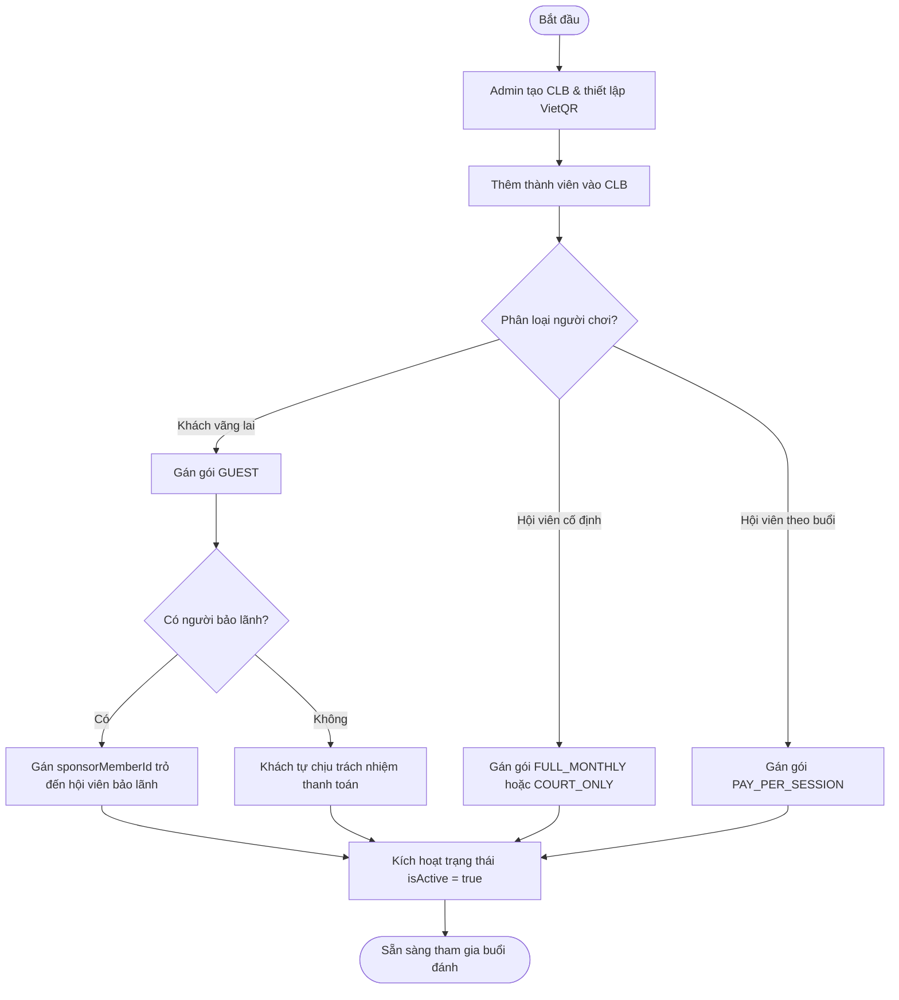
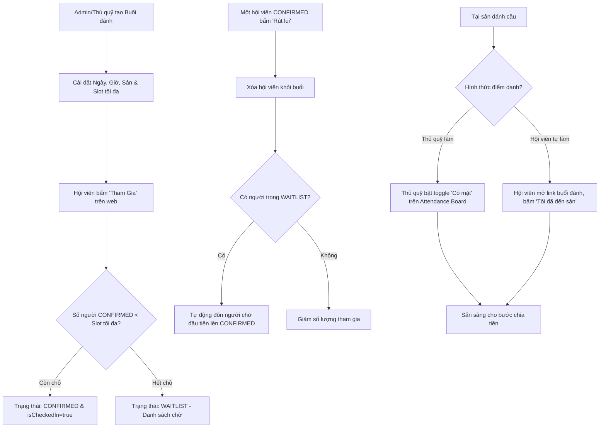
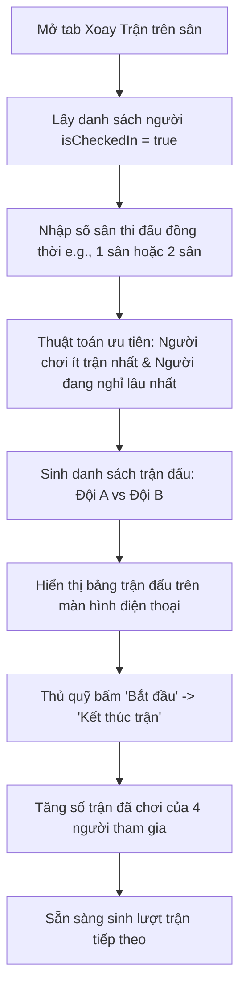
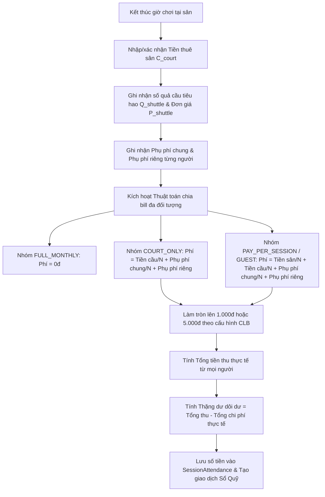
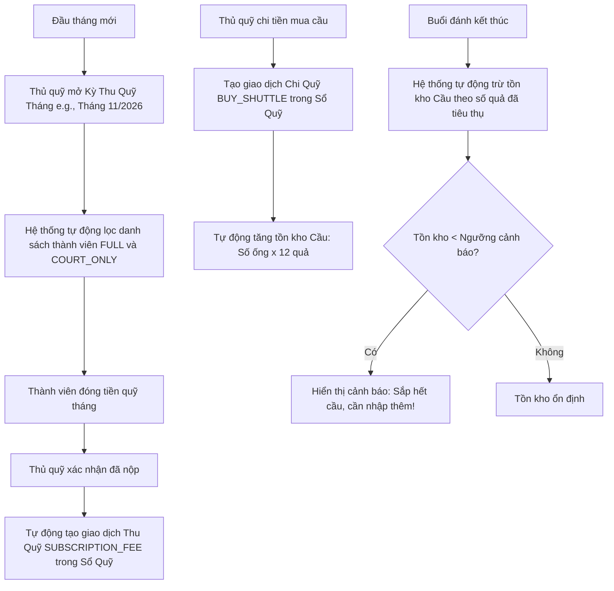

# CÁC LUỒNG NGHIỆP VỤ HỆ THỐNG CHI TIẾT (BUSINESS WORKFLOWS)
## Badminton Sport Manager (BSM)

---

## LUỒNG 1: QUẢN LÝ CÂU LẠC BỘ, THÀNH VIÊN & BẢO LÃNH KHÁCH VÃNG LAI

### 1.1. Mục đích nghiệp vụ
Tạo lập không gian sinh hoạt chung cho nhóm cầu lông, phân định vai trò, thiết lập thông tin ngân hàng thanh toán và quản lý hồ sơ của mọi người chơi (cố định và vãng lai).

### 1.2. Sơ đồ quy trình (Workflow Diagram)


### 1.3. Các bước xử lý chi tiết & Ràng buộc
1. **Khởi tạo CLB:**
   - Trưởng nhóm tạo CLB với tên nhóm, địa điểm sinh hoạt mặc định.
   - Cài đặt tài khoản ngân hàng nhận tiền: Mã ngân hàng (VietQR Bin code), Số tài khoản, Tên chủ tài khoản.
   - Cài đặt quy tắc làm tròn mặc định: `CEIL_1K` (làm tròn lên 1.000đ) hoặc `CEIL_5K` (làm tròn lên 5.000đ).
2. **Thêm thành viên:**
   - Trường hợp 1: Hội viên đã có tài khoản trên web $\rightarrow$ Gắn kết `userId` của tài khoản đó.
   - Trường hợp 2: Ban tổ chức tạo trước hồ sơ ảo (tên + số điện thoại) để theo dõi điểm danh và nợ. Khi hội viên đăng ký tài khoản thật với số điện thoại/email đó, hệ thống sẽ tự động liên kết.
3. **Quản lý khách vãng lai & Bảo lãnh:**
   - Khi có khách mới đến giao lưu, Thủ quỹ chọn "Thêm khách vãng lai".
   - Nếu khách là bạn của một hội viên trong nhóm, Thủ quỹ chọn **Hội viên bảo lãnh**.
   - Ý nghĩa nghiệp vụ: Nếu khách quên thanh toán hoặc về sớm, khoản nợ của khách có thể được Thủ quỹ chuyển gộp vào tài khoản của người bảo lãnh để nhắc nợ dễ dàng.
4. **Cơ chế Soft-Delete (Xóa mềm):**
   - Khi một thành viên rời nhóm hoặc nghỉ chơi, Ban tổ chức nhấn "Xóa hội viên".
   - Hệ thống **tuyệt đối không xóa bản ghi trong DB** mà chỉ cập nhật cờ `isActive = false`.
   - Toàn bộ lịch sử điểm danh, các khoản nợ cũ chưa thanh toán và thống kê số buổi tham gia vẫn được lưu giữ trọn vẹn.

---

## LUỒNG 2: LẬP LỊCH BUỔI ĐÁNH, SLOT, DANH SÁCH CHỜ & ĐIỂM DANH 2 CHIỀU

### 2.1. Mục đích nghiệp vụ
Tổ chức buổi sinh hoạt cầu lông có kiểm soát số lượng người tham gia, tránh tình trạng quá tải sân hoặc thiếu người, và ghi nhận chính xác những ai thực tế có mặt trên sân để làm cơ sở chia tiền.

### 2.2. Sơ đồ quy trình (Workflow Diagram)


### 2.3. Các bước xử lý chi tiết & Ràng buộc
1. **Lập lịch buổi đánh:**
   - Nhập tiêu đề, ngày diễn ra, giờ bắt đầu/kết thúc, tên sân vận động/câu lạc bộ.
   - Nhập tiền sân dự kiến ($C_{court}$) và đơn giá tiền cầu dự kiến ($P_{shuttle}$).
   - Thiết lập `maxAttendees` (ví dụ 6 người/sân, thuê 2 sân thì tối đa 12 người).
2. **Đăng ký tham gia & Cơ chế Waitlist:**
   - Thành viên đăng nhập và bấm nút "Đăng ký tham gia".
   - Nếu số lượng người `CONFIRMED` hiện tại $< maxAttendees$: Ghi nhận trạng thái `CONFIRMED`.
   - Nếu số lượng đã đạt trần: Hệ thống ghi nhận trạng thái `WAITLIST` (Danh sách chờ). Giao diện hiển thị badge màu vàng thông báo rõ ràng cho hội viên.
3. **Cơ chế Auto-promote (Tự động đôn slot):**
   - Khi bất kỳ hội viên nào trong danh sách chính thức bấm "Rút lui" (hoặc do Ban tổ chức gỡ ra), hệ thống tìm người đăng ký sớm nhất trong danh sách `WAITLIST` và tự động cập nhật người đó thành `CONFIRMED`.
   - Đảm bảo sân luôn đạt công suất tối đa mà không cần Thủ quỹ phải rà soát thủ công.
4. **Điểm danh 2 chiều (Two-way Attendance):**
   - **Chiều 1 (Self Check-in):** Hội viên khi đến sân mở điện thoại bấm nút "Tôi đã có mặt tại sân". Hệ thống cập nhật `isCheckedIn = true`.
   - **Chiều 2 (Host Attendance Board):** Thủ quỹ có một bảng danh sách dạng thẻ trực quan. Thủ quỹ có thể bấm toggle có mặt/vắng mặt cho từng người, hoặc thêm nhanh khách vãng lai bất chợt đến sân.
   - Chỉ những ai có `isCheckedIn = true` mới được đưa vào thuật toán phân bổ chi phí.

---

## LUỒNG 3: BỐC THĂM GHÉP TRẬN TẠI SÂN (COURT MATCHMAKER & ROTATION)

### 3.1. Mục đích nghiệp vụ
Tự động ghép các cặp đấu đôi (4 người/trận) dựa trên danh sách những người đang có mặt trên sân, đảm bảo số lần thi đấu đồng đều và luân phiên người ngồi nghỉ hợp lý.

### 3.2. Sơ đồ quy trình (Workflow Diagram)


### 3.3. Các bước xử lý chi tiết
1. **Lựa chọn người chơi tham gia:** Hệ thống tự động lọc danh sách thành viên có cờ `isCheckedIn = true` trong buổi đánh.
2. **Cấu hình sân đấu:** Chọn số lượng sân mở đồng thời (mặc định theo cấu hình buổi đánh, e.g. 1 hoặc 2 sân).
3. **Thuật toán ghép cặp:**
   - Đếm số trận đã đấu ($Count_{match}$) của từng người trong buổi hiện tại.
   - Sắp xếp ưu tiên: Những người có $Count_{match}$ thấp nhất được ưu tiên xếp vào sân trước.
   - Bốc thăm ngẫu nhiên ghép cặp đôi: Đội A (2 người) vs Đội B (2 người).
   - Những người chưa được xếp vào lượt này hiển thị ở trạng thái "Nghỉ ngơi" (Resting/Waiting next round).
4. **Điều khiển lượt trận:**
   - Khi trận đấu diễn ra, bấm "Bắt đầu".
   - Khi trận đấu xong, bấm "Kết thúc trận" $\rightarrow$ Hệ thống tự động cộng 1 vào số trận đã chơi của các thành viên này và cập nhật hàng đợi lượt sau.

---

## LUỒNG 4: ĐẾM CẦU, PHỤ PHÍ & THUẬT TOÁN CHIA HÓA ĐƠN (SPLITTING ENGINE)

### 4.1. Mục đích nghiệp vụ
Tính toán chính xác số tiền từng người tham gia phải nộp, dựa trên loại hình hội viên của họ, số cầu thực tế đã tiêu thụ, chi phí sân và các phụ phí riêng/chung phát sinh.

### 4.2. Sơ đồ quy trình (Workflow Diagram)


### 4.3. Công thức toán học & Quy tắc làm tròn
1. **Các biến số đầu vào:**
   - Tiền sân: $C_{court}$
   - Số cầu đã mở: $Q_{shuttle}$; Đơn giá 1 quả: $P_{shuttle} \rightarrow C_{shuttle} = Q_{shuttle} \times P_{shuttle}$
   - Phụ phí chung buổi đánh: $C_{extra\_shared}$
   - Phụ phí riêng của người thứ $i$: $Extra_i$
   - Tổng số người có mặt thực tế: $N_{present} = N_{full} + N_{court\_only} + N_{session}$

2. **Công thức phân bổ chi tiết cho từng người thứ $i$:**
   - **Trường hợp A: Hội viên Trọn Gói Tháng (`FULL_MONTHLY`):**
     $$Fee_i = Extra_i$$
     *(Nếu không uống nước riêng thì $Fee_i = 0$đ, trạng thái thanh toán tự động đánh dấu `COVERED_BY_SUBSCRIPTION`)*.
   - **Trường hợp B: Hội viên Gói Tháng Chỉ Sân (`COURT_ONLY_MONTHLY`):**
     Được miễn tiền sân, chỉ chia tiền cầu và phụ phí chung:
     $$Fee_{raw} = \frac{C_{shuttle}}{N_{present}} + \frac{C_{extra\_shared}}{N_{present}} + Extra_i$$
     $$Fee_i = \lceil \frac{Fee_{raw}}{RoundUnit} \rceil \times RoundUnit$$
   - **Trường hợp C: Hội viên Theo Buổi (`PAY_PER_SESSION`) hoặc Khách Vãng Lai (`GUEST`):**
     Chịu toàn bộ chi phí sân, cầu và phụ phí chung chia đều:
     $$Fee_{raw} = \frac{C_{court}}{N_{present}} + \frac{C_{shuttle}}{N_{present}} + \frac{C_{extra\_shared}}{N_{present}} + Extra_i$$
     $$Fee_i = \lceil \frac{Fee_{raw}}{RoundUnit} \rceil \times RoundUnit$$

3. **Cơ chế hạch toán Thặng dư làm tròn (Surplus):**
   - Tổng tiền thu từ các thành viên: $Total_{collected} = \sum_{i=1}^{N_{present}} Fee_i$
   - Chi phí thực tế phải chi trả cho chủ sân và chi phí gốc: $Cost_{actual} = C_{court} + C_{shuttle} + C_{extra\_shared} + \sum Extra_i$
   - Khoản chênh lệch thặng dư: $\Delta = Total_{collected} - Cost_{actual}$
   - Hệ thống tự động ghi nhận một giao dịch `INCOME` vào bảng `Transaction` (danh mục `SESSION_FEE` hoặc `SESSION_SURPLUS`) với số tiền bằng $\Delta$, đảm bảo quỹ CLB luôn tăng trưởng minh bạch từ các khoản làm tròn tiền lẻ.

---

## LUỒNG 5: THANH TOÁN, TẠO MÃ VIETQR, GẠCH NỢ & XUẤT TIN NHẮN ZALO

### 5.1. Mục đích nghiệp vụ
Tạo điều kiện thuận tiện nhất để người chơi thanh toán qua Internet Banking không sai số tiền/cú pháp, và giúp Thủ quỹ đối soát, gạch nợ đơn hoặc gạch nợ gộp tức thì.

### 5.2. Sơ đồ quy trình (Workflow Diagram)
```mermaid
flowchart TD
    BillCalculated[Đã có số tiền phải nộp] --> ChoosePaymentType{Hình thức xem thanh toán?}
    
    ChoosePaymentType -->|Xem tại buổi đánh| SingleSessionQR[Mở Dialog Hóa Đơn Buổi Đánh]
    SingleSessionQR --> GenSingleQR[Tạo link VietQR đơn lẻ: Tiền buổi + Cú pháp BSM [Tên] [Buổi]]
    
    ChoosePaymentType -->|Xem trong Quản lý Nợ| DebtTrackerQR[Mở Bảng Theo Dõi Nợ CLB]
    DebtTrackerQR --> GenConsolidatedQR[Tạo link VietQR gộp toàn bộ các buổi chưa trả]
    
    GenSingleQR --> MemberScan[Người chơi mở App Ngân hàng quét QR chuyển khoản]
    GenConsolidatedQR --> MemberScan
    
    MemberScan --> BankTransfer[Tiền về tài khoản Thủ quỹ]
    BankTransfer --> HostAction{Thủ quỹ đối soát và xác nhận}
    
    HostAction -->|Gạch nợ đơn buổi| SettleSingle[Nhấn 'Xác nhận nộp' -> paymentStatus = 'PAID']
    HostAction -->|Gạch nợ toàn bộ| SettleBatch[Nhấn 'Thanh toán tất cả' -> Chạy settleAllDebtsForMember]
    
    SettleBatch --> AtomicTx[Prisma $transaction: Đổi toàn bộ bản ghi UNPAID -> PAID]
    
    HostAction --> ExportZalo[Bấm 'Sao chép văn bản Zalo']
    ExportZalo --> PasteZaloChat[Dán vào nhóm Zalo/Messenger của CLB nhắc nhở]
```

### 5.3. Các bước xử lý chi tiết & Cấu trúc mã VietQR
1. **Chuẩn hóa mã VietQR QuickLink:**
   - Cấu trúc URL tiêu chuẩn Napas247:
     `https://img.vietqr.io/image/<BANK_BIN>-<ACCOUNT_NO>-compact2.png?amount=<AMOUNT>&addInfo=<MESSAGE>&accountName=<ACCOUNT_NAME>`
   - Trường hợp thanh toán đơn buổi: `<MESSAGE>` = `BSM [Ten_Thanh_Vien] [Ma_Buoi]`
   - Trường hợp thanh toán gộp công nợ: `<MESSAGE>` = `BSM [Ten_Thanh_Vien] GOP [Tong_So_Buoi]B`
2. **Cơ chế Gạch nợ đơn lẻ (Single Settle):**
   - Thủ quỹ bấm nút check bên cạnh tên thành viên tại trang chi tiết buổi đánh. Trạng thái chuyển đổi ngay lập tức giữa `UNPAID` $\leftrightarrow$ `PAID`.
3. **Cơ chế Gạch nợ gộp (Consolidated Batch Settle):**
   - Tại màn hình **Quản lý Nợ (Debt Tracker)**, hệ thống gom nhóm toàn bộ các khoản nợ của từng thành viên qua tất cả các buổi đánh từ trước đến nay.
   - Khi thành viên chuyển một cục tiền lớn trả hết nợ, Thủ quỹ chỉ cần bấm 1 nút **"Thanh toán tất cả (Gạch nợ)"**.
   - Server Action `settleAllDebtsForMember` thực thi trong `db.$transaction`: Cập nhật đồng loạt toàn bộ các bản ghi `SessionAttendance` của thành viên đó từ `UNPAID` sang `PAID` kèm ngày thanh toán `paidAt = now()`.
4. **Mẫu tin nhắn sao chép Zalo tự động:**
   - Hệ thống tạo sẵn mẫu tin nhắn định dạng chuẩn để gửi vào nhóm chat:
     ```text
     🏸 TỔNG HỢP TIỀN BUỔI ĐÁNH [Ngày/Giờ] - CLB [Tên CLB]
     ----------------------------------------
     1. Nguyễn Văn A: 50.000đ (Đã đóng)
     2. Trần Văn B: 65.000đ (Chưa đóng - gồm nước ngọt)
     3. Lê Văn C (Khách): 50.000đ (Chưa đóng)
     ----------------------------------------
     Tổng tiền cần thu: 165.000đ | Đã thu: 50.000đ | Còn nợ: 115.000đ
     STK: 0912345678 - MB Bank - NGUYEN VAN THU QUY
     Cú pháp: BSM [Tên bạn]
     ```

---

## LUỒNG 6: THU QUỸ THÁNG, QUẢN TRỊ KHO CẦU & SỔ QUỸ TÀI CHÍNH

### 6.1. Mục đích nghiệp vụ
Duy trì dòng tiền hoạt động bền vững cho CLB, quản lý minh bạch việc thu hội phí tháng cố định, kiểm soát chính xác số lượng cầu lông nhập - xuất tồn để chống thất thoát.

### 6.2. Sơ đồ quy trình (Workflow Diagram)


### 6.3. Các bước xử lý chi tiết & Tích hợp liên module
1. **Quản lý Kỳ Quỹ Tháng (Monthly Subscription Periods):**
   - Ban tổ chức tạo kỳ thu quỹ (Tên kỳ: ví dụ "Quỹ Tháng 11/2026", Số tiền định mức: ví dụ 300.000đ/thành viên trọn gói, 150.000đ/thành viên chỉ sân).
   - Hệ thống tự động khởi tạo danh sách các khoản phải nộp (`MonthlyMemberPayment`) cho các thành viên có `membershipType` tương ứng.
   - Khi thành viên thanh toán, Thủ quỹ chuyển trạng thái `isPaid = true`.
   - **Tích hợp tự động:** Ngay khi `isPaid` chuyển sang `true`, hệ thống tự động sinh một bản ghi `Transaction` loại `INCOME`, hạng mục `SUBSCRIPTION_FEE` vào Sổ Quỹ với số tiền tương ứng.
2. **Quản lý Kho Cầu (Shuttlecock Inventory):**
   - Đơn vị tính: Lưu trữ trong cơ sở dữ liệu theo đơn vị **Quả (piece)** để đảm bảo tính toán chính xác tuyệt đối khi mở lẻ cầu tại sân.
   - Khi mua cầu: Nhập số ống (hộp) $\rightarrow$ Hệ thống tự quy đổi thành: `Số ống x 12 quả` và cộng dồn vào `shuttlecockInventory` của CLB.
   - Khi diễn ra buổi đánh: Ghi nhận số quả cầu đã dùng vào `shuttleCount` của buổi đánh.
   - Khi buổi đánh chuyển sang trạng thái `COMPLETED`: Hệ thống tự động trừ số lượng quả cầu tương ứng vào tồn kho của CLB.
3. **Báo cáo Sổ Quỹ (Treasury Ledger):**
   - Cung cấp bức tranh toàn cảnh dòng tiền của CLB:
     - **Tổng thu (Total Inflow):** Tiền quỹ tháng + Thặng dư buổi đánh + Tài trợ/Ủng hộ.
     - **Tổng chi (Total Outflow):** Tiền mua cầu + Tiền thuê sân cố định + Chi phí liên hoan/mua sắm thiết bị.
     - **Số dư quỹ khả dụng (Current Balance):** Luôn được tính toán theo thời gian thực: `Số dư = Tổng thu - Tổng chi`.
