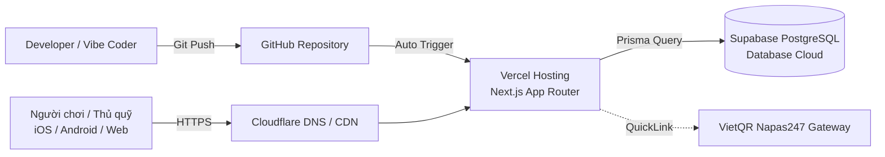

# Hướng Dẫn Triển Khai Hệ Thống (Deployment Guide)

Tài liệu này hướng dẫn chi tiết quy trình đưa ứng dụng **Badminton Sport Manager (BSM)** từ môi trường lập trình cục bộ (Local) lên môi trường mạng Internet (Production) với chi phí 0đ (Free-tier tối ưu) và độ ổn định cao.

---

## 1. Kiến Trúc Triển Khai Khuyến Nghị (Production Stack)



- **Hosting & Serverless Compute**: [Vercel](https://vercel.com) (Tối ưu 100% cho Next.js, tự động build CI/CD khi push code, miễn phí).
- **Cơ Sở Dữ Liệu Cloud**: [Supabase](https://supabase.com) hoặc [Neon.tech](https://neon.tech) (PostgreSQL Serverless, hỗ trợ Pooler connection, backup tự động, gói Free 500MB đủ dùng cho nhiều năm hoạt động của CLB).
- **Tên miền & Bảo mật**: Tên miền tuỳ chỉnh trỏ qua Vercel DNS hoặc Cloudflare (tự động cấp chứng chỉ bảo mật HTTPS/SSL miễn phí).

---

## 2. Quy Trình 5 Bước Triển Khai Lên Mạng

### Bước 1: Khởi Tạo Cơ Sở Dữ Liệu Trên Supabase
1. Đăng ký tài khoản miễn phí tại [supabase.com](https://supabase.com).
2. Tạo một Project mới (chọn khu vực gần Việt Nam nhất: **Singapore - ap-southeast-1** để giảm độ trễ ping).
3. Vào mục **Settings -> Database -> Connection string**:
   - Sao chép chuỗi kết nối **URI (Session Pooler)** dùng cho `DATABASE_URL`.
   - Sao chép chuỗi kết nối **Direct Connection** dùng cho `DIRECT_URL` (dành cho Prisma Migration).

### Bước 2: Thiết Lập Quản Lý Mã Nguồn Trên GitHub
1. Khởi tạo Git repo cục bộ (nếu chưa có):
   ```bash
   git init
   git add .
   git commit -m "feat: complete project scaffold and docs"
   ```
2. Tạo repository mới trên GitHub (chế độ `Private` hoặc `Public`).
3. Đẩy code lên GitHub:
   ```bash
   git remote add origin https://github.com/<your-username>/BSM_BadmintonSportManager.git
   git branch -M main
   git push -u origin main
   ```

### Bước 3: Cấu Hình Tự Động Migration Khi Build
Trong file `package.json` của dự án Next.js, thiết lập câu lệnh build để Prisma tự động cập nhật cấu trúc bảng lên Supabase mỗi lần deploy:
```json
{
  "scripts": {
    "dev": "next dev",
    "build": "prisma generate && prisma migrate deploy && next build",
    "start": "next start"
  }
}
```

### Bước 4: Kết Nối Dự Án Lên Vercel
1. Đăng nhập vào [vercel.com](https://vercel.com) bằng tài khoản GitHub.
2. Bấm **Add New... -> Project** và chọn repository `BSM_BadmintonSportManager`.
3. Trong phần **Environment Variables**, khai báo các biến môi trường sau:
   - `DATABASE_URL`: *Chuỗi kết nối Pooled từ Supabase*
   - `DIRECT_URL`: *Chuỗi kết nối Direct từ Supabase*
   - `NEXTAUTH_SECRET`: *Chuỗi ngẫu nhiên bảo mật (tạo bằng lệnh `openssl rand -base64 32`)*
   - `NEXTAUTH_URL`: *URL ứng dụng trên Vercel (hoặc domain tùy chỉnh)*
   - `NEXT_PUBLIC_APP_URL`: *URL ứng dụng chính thức*
4. Bấm **Deploy**. Vercel sẽ tự động build code, chạy migration tạo các bảng trên PostgreSQL và cung cấp tên miền miễn phí (dạng `https://bsm-badminton.vercel.app`).

### Bước 5: Gắn Tên Miền Riêng & Cài Đặt PWA (Tuỳ chọn)
1. **Gắn Domain**: Vào Settings của Project trên Vercel -> mục **Domains** -> nhập tên miền (ví dụ: `caulongclub.vn`) và trỏ bản ghi CNAME / A theo hướng dẫn.
2. **Kích hoạt PWA**: Bổ sung `manifest.json` và service-worker để khi người chơi mở trên Safari (iOS) hoặc Chrome (Android), họ có thể bấm **"Thêm vào Màn hình chính" (Add to Home Screen)** để dùng như app tải từ App Store.

---

## 3. Khả Năng Mở Rộng & Chi Phí Vận Hành
- **Chi phí dự kiến**: **0 VNĐ / tháng** cho quy mô thông thường (1-5 nhóm cầu lông, hàng nghìn buổi đánh và giao dịch).
  - Vercel Hobby Tier: Miễn phí băng thông và serverless functions.
  - Supabase Free Tier: 500MB database, 50.000 người dùng hoạt động hàng tháng.
  - VietQR QuickLink API: Sử dụng hoàn toàn miễn phí không giới hạn lượt tạo mã.
