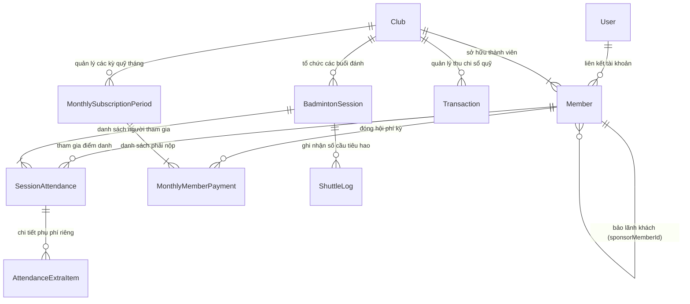

# MA TRẬN PHỤ THUỘC & LUỒNG LIÊN KẾT LIÊN MODULE (MODULE DEPENDENCIES)
## Badminton Sport Manager (BSM)

---

## 1. MA TRẬN PHỤ THUỘC DỮ LIỆU GIỮA CÁC THỰC THỂ (ENTITY DEPENDENCY MATRIX)

Hệ thống BSM được xây dựng xoay quanh 9 thực thể dữ liệu cốt lõi trong Prisma Schema. Mối quan hệ giữa các thực thể tuân thủ nghiêm ngặt tính toàn vẹn dữ liệu:



### Bảng phân tích chi tiết quan hệ thực thể:

| Thực Thể Gốc (Parent Entity) | Thực Thể Phụ Thuộc (Dependent Entity) | Kiểu Quan Hệ | Khóa Ngoại (Foreign Key) | Hành Vi Khi Xóa (On Delete) | Đánh Giá Tính Hợp Lý & Rủi Ro |
| :--- | :--- | :---: | :--- | :--- | :--- |
| **Club** | `Member` | 1 - N | `clubId` | `Cascade` | Hợp lý. Nếu xóa CLB thì danh sách thành viên trong CLB đó bị xóa. Tuy nhiên ở tầng nghiệp vụ chỉ cho phép xóa mềm. |
| **Club** | `BadmintonSession` | 1 - N | `clubId` | `Cascade` | Cần chặn ở tầng Server Action nếu buổi đánh đã phát sinh giao dịch tiền tệ (`PAID`). |
| **Club** | `Transaction` | 1 - N | `clubId` | `Cascade` | Bản ghi sổ quỹ gắn chặt với CLB. |
| **Club** | `MonthlySubscriptionPeriod` | 1 - N | `clubId` | `Cascade` | Các kỳ thu quỹ thuộc về CLB. |
| **Member** | `SessionAttendance` | 1 - N | `memberId` | `Cascade` (DB) / **Soft-Delete (App)** | **Điểm mấu chốt:** Không bao giờ xóa cứng `Member` khi đã có `SessionAttendance`. Sử dụng `isActive = false` để bảo vệ số liệu nợ. |
| **Member** | `Member` (Sponsor) | 1 - N (Tự tham chiếu) | `sponsorMemberId` | `SetNull` | Khi người bảo lãnh rời nhóm, khách vãng lai trở thành khách độc lập, không làm mất bản ghi khách. |
| **BadmintonSession** | `SessionAttendance` | 1 - N | `sessionId` | `Cascade` (DB) / **Chặn nếu PAID (App)** | Nếu buổi đánh đã có người đóng tiền, Server Action chủ động từ chối lệnh xóa để tránh mất dấu vết dòng tiền. |
| **BadmintonSession** | `ShuttleLog` | 1 - N | `sessionId` | `Cascade` | Lịch sử cầu mở theo từng buổi. |
| **SessionAttendance** | `AttendanceExtraItem`| 1 - N | `attendanceId` | `Cascade` | Chi tiết các món phụ phí (nước uống) gắn liền với lượt tham gia của thành viên. |
| **MonthlySubscriptionPeriod** | `MonthlyMemberPayment` | 1 - N | `periodId` | `Cascade` | Bản ghi nghĩa vụ nộp tiền quỹ tháng gắn với kỳ tương ứng. |

---

## 2. LUỒNG DỮ LIỆU LIÊN KẾT XUYÊN SUỐT CÁC PHÂN HỆ (CROSS-MODULE WORKFLOWS)

### 2.1. Luồng Liên Kết 1: Điểm Danh $\rightarrow$ Kho Cầu $\rightarrow$ Chia Bill $\rightarrow$ Sổ Quỹ
Đây là luồng xương sống của hệ thống, diễn ra trong mỗi buổi đánh:

```text
[MOD-03: Vận Hành Buổi Đánh]
  │
  ├─► Ghi nhận danh sách tham gia (SessionAttendance) với isCheckedIn = true
  ├─► Ghi nhận số quả cầu tiêu hao (ShuttleLog) -> Cập nhật shuttleCount
  │
[MOD-07: Kho Cầu]
  │
  ├─► Khi trạng thái buổi chuyển thành 'COMPLETED':
  │     Club.shuttlecockInventory = Club.shuttlecockInventory - Session.shuttleCount
  │
[MOD-05: Thuật Toán Chia Tiền]
  │
  ├─► Đọc C_court, Q_shuttle, P_shuttle, ExtraItems và phân loại Member (FULL/COURT_ONLY/SESSION)
  ├─► Tính toán và cập nhật: SessionAttendance.calculatedFee (đã làm tròn 1k/5k)
  ├─► Tính khoản thặng dư: Delta = Total_collected - Actual_cost
  │
[MOD-07: Sổ Quỹ CLB]
  │
  └─► Tự động tạo bản ghi Transaction:
        type = 'INCOME', category = 'SESSION_FEE', amount = Delta
        description = "Thặng dư dôi dư làm tròn buổi đánh [Tên Buổi]"
```

### 2.2. Luồng Liên Kết 2: Quản Lý Nợ $\rightarrow$ VietQR $\rightarrow$ Gạch Nợ $\rightarrow$ Sổ Quỹ
Đảm bảo thu hồi công nợ minh bạch và đồng bộ tức thì:

```text
[MOD-06: Bảng Theo Dõi Nợ (Debt Tracker)]
  │
  ├─► Gom nhóm toàn bộ SessionAttendance có paymentStatus = 'UNPAID' theo từng Member
  ├─► Tính tổng nợ tích lũy (Total Debt) của mỗi cá nhân qua tất cả các buổi
  │
[MOD-06: Sinh Mã VietQR Gộp]
  │
  ├─► Sinh mã QR Napas247 với số tiền đúng bằng Tổng Nợ Tích Lũy
  ├─► Cú pháp nhận diện: "BSM [Tên] GOP [Số_Buổi]B"
  │
[Thực thi Server Action: settleAllDebtsForMember]
  │
  └─► Bọc trong db.$transaction nguyên tử:
        1. UPDATE SessionAttendance SET paymentStatus = 'PAID', paidAt = now() WHERE memberId = X AND paymentStatus = 'UNPAID'
        2. Trả về số lượng bản ghi đã được gạch nợ thành công
        3. Giao diện Debt Tracker tự động xóa bỏ trạng thái nợ của thành viên này
```

### 2.3. Luồng Liên Kết 3: Thu Quỹ Tháng $\rightarrow$ Miễn Trừ Tiền Sân Buổi $\rightarrow$ Hạch Toán Sổ Quỹ
Gắn kết nghĩa vụ đóng quỹ định kỳ với quyền lợi miễn giảm khi ra sân:

```text
[MOD-07: Quỹ Tháng (Monthly Subscription)]
  │
  ├─► Tạo kỳ thu quỹ (MonthlySubscriptionPeriod) cho tháng T
  ├─► Tự động sinh danh sách MonthlyMemberPayment cho các hội viên FULL_MONTHLY và COURT_ONLY_MONTHLY
  │
[MOD-07: Ghi Nhận Đóng Tiền Quỹ Tháng]
  │
  ├─► Thủ quỹ bấm xác nhận đã đóng: MonthlyMemberPayment.isPaid = true
  ├─► Tự động tạo Transaction trong Sổ Quỹ:
  │     type = 'INCOME', category = 'SUBSCRIPTION_FEE', amount = MonthlyMemberPayment.amount
  │
[MOD-05: Thuật Toán Chia Tiền Trong Tháng T]
  │
  ├─► Khi chia tiền các buổi đánh trong tháng:
  │     - Nếu Member là FULL_MONTHLY: Miễn 100% tiền sân & tiền cầu (Fee = Phụ phí riêng)
  │     - Nếu Member là COURT_ONLY_MONTHLY: Miễn tiền sân (Fee = Tiền cầu/N + Phụ phí)
  │     - Nếu Member là PAY_PER_SESSION: Chịu đầy đủ tiền sân chia đều + tiền cầu/N
```

---

## 3. RÀNG BUỘC TOÀN VẸN DỮ LIỆU & GIAO DỊCH NGUYÊN TỬ (ACID CONSTRAINTS)

Để tránh hiện tượng dữ liệu không đồng nhất (Data Inconsistency) hoặc xung đột đồng thời (Race Condition), hệ thống áp dụng các nguyên tắc bảo vệ sau:

1. **Giao dịch nguyên tử (`db.$transaction`):**
   - Áp dụng bắt buộc trong Server Action `settleAllDebtsForMember`: Đảm bảo hoặc toàn bộ các buổi nợ được chuyển sang `PAID`, hoặc không bản ghi nào bị thay đổi nếu gặp sự cố mạng/DB.
   - Áp dụng khi tạo bản ghi nhập kho cầu kết hợp chi tiền Sổ Quỹ (`BUY_SHUTTLE`): Tồn kho tăng và số dư quỹ giảm phải diễn ra đồng thời.
2. **Ngăn chặn Orphan Records (Bản ghi mồ côi):**
   - Không cho phép tạo `SessionAttendance` trỏ đến `memberId` không tồn tại hoặc đã bị vô hiệu hóa (`isActive = false`).
   - Mọi phụ phí riêng (`AttendanceExtraItem`) bắt buộc phải gắn với một `SessionAttendance` hợp lệ.
3. **Cơ chế Soft-Delete bảo vệ Lịch sử:**
   - Trường `isActive: Boolean` trên bảng `Member` là rào chắn bắt buộc. Khi tìm kiếm danh sách thành viên để thêm vào buổi đánh, luôn áp dụng bộ lọc `where: { isActive: true }`. Khi thống kê nợ hoặc lịch sử thi đấu, bỏ qua bộ lọc này để hiển thị đầy đủ quá khứ.
